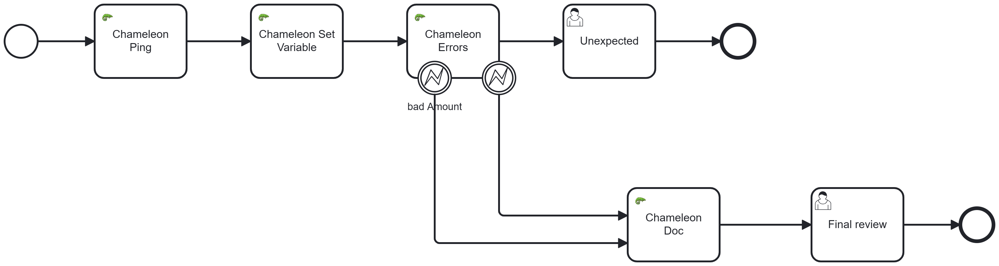

[](https://github.com/Camunda-Community-Hub/community/blob/main/extension-lifecycle.md#stable-)
[](https://github.com/camunda-community-hub/community)


# camunda-8-connector-chameleon


<a href="https://www.vecteezy.com/free-vector/chameleon">Chameleon Vectors by Vecteezy</a>

The Chameleon connector mimics any connector. It is designed for process development and testing: use it as a placeholder when the real connector is not ready yet, to simulate delays, produce variables, trigger BPMN errors on demand, or work with Camunda documents.



---

## Features at a glance

| Feature          | Input flag            | Purpose                                           |
|------------------|-----------------------|---------------------------------------------------|
| Delay            | `sleep`               | Pause execution to simulate latency               |
| Ping             | `pingSimulation`      | Return a timestamp and the connector's IP address |
| Operations       | `operationSimulation` | Compute and return a map of variables             |
| Error simulation | `errorSimulation`     | Throw a BPMN error with configurable probability  |
| Document         | `documentSimulation`  | Read or write a Camunda document                  |

Each feature is independently enabled by its boolean flag. All features can be combined in a single task.

---

## Delay

Input: `sleep` (Long, milliseconds, default `0`)

The connector waits the given number of milliseconds before completing. Use this for load tests or to simulate a slow external service.

---

## Ping

Input flag: `pingSimulation` (Boolean)

When enabled, the connector logs the optional `pingMessage` and returns:

| Output variable           | Type   | Description                                        |
|---------------------------|--------|----------------------------------------------------|
| `result.pingTimeStampMS`  | Long   | Epoch timestamp in milliseconds at execution time  |
| `result.pingIpAddress`    | String | IP address of the host running the connector       |
| `result.pingMessage`      | String | Echo of the `pingMessage` input                    |

---

## Operations

Input flag: `operationSimulation` (Boolean)

When enabled, the connector evaluates a map of operations and returns the results as `result.operationValue` (a `Map<String, Object>`). Each key in the `operations` input becomes a key in the output map.

### Input format

```json
{
  "myDate":     "date()",
  "myDatetime": "datetime()",
  "myLocalDate": "localdate()",
  "myLocalTime": "Localtime()",
  "myZoned":    "zoneddatetime()",
  "myConstInt": 12,
  "myConstStr": "\"hello world\"",
  "myFromVar":  "pingIpAddress"
}
```

### Supported value types

| Value                                | Behaviour                                          |
|--------------------------------------|----------------------------------------------------|
| A number (`12`, `3.14`)              | Used as-is                                         |
| A quoted string (`"\"hello\""`)      | Used as a string literal                           |
| An unquoted string (`pingIpAddress`) | Resolved as a process variable by that name        |
| `date()`                             | Current date (`java.util.Date`, ISO format)        |
| `datetime()`                         | Current date and time (`java.util.Date`)           |
| `localdate()`                        | Current local date (`LocalDate`, e.g. `2026-07-17`) |
| `Localtime()`                        | Current local date-time (`LocalDateTime`)          |
| `zoneddatetime()`                    | Current zoned date-time (`ZonedDateTime`)          |
| `JSON(<json>)`                       | Parses the argument as a JSON object               |

### Output

All computed values are returned as a single map in `result.operationValue`. To expose individual entries as process variables, add output mappings in the BPMN:

```xml
<zeebe:output source="= result.operationValue.myDatetime" target="pingOpDatetime" />
```

---

## Error simulation

Input flag: `errorSimulation` (Boolean)

When enabled, the connector randomly selects and throws a BPMN error according to a list of rules. Each rule specifies an error code, a probability percentage, and an optional message.

### Input format

```json
[
  { "code": "BAD_AMOUNT",  "%": 50, "message": "Amount must be positive" },
  { "code": "BAD_ACCOUNT", "%": 30 }
]
```

- Rules are evaluated in order. The connector draws a random number (0–100) and throws the first rule whose cumulative percentage covers it.
- If the total percentage is less than 100, the remaining probability produces no error.
- The `message` field is optional.

### Catching the error in BPMN

Add a boundary error event on the task. The engine populates `error.code` and `error.message` in the boundary event scope. Use output mappings to promote them to process variables:

```xml
<bpmn:extensionElements>
  <zeebe:ioMapping>
    <zeebe:output source="=error.code"    target="errorCode" />
    <zeebe:output source="=error.message" target="errorMessage" />
  </zeebe:ioMapping>
</bpmn:extensionElements>
```

---

## Document

Input flag: `documentSimulation` (Boolean)

### Reading a document

Set `readDocumentName` to the name of the process variable that holds the `DocumentReference`. The connector resolves the document and logs its size.

### Writing a document

Set `writeDocumentName` (the filename) and `writeDocumentContent` (a text string). The connector creates a UTF-8 text document in the Camunda document store and returns its reference.

| Output variable         | Type                 | Description                        |
|-------------------------|----------------------|------------------------------------|
| `result.documentWrite`  | `DocumentReference`  | Reference to the created document  |

Map this to a process variable in the BPMN output mappings, then use it in a form with the `documentPreview` component:

```json
{ "type": "documentPreview", "dataSource": "=pingDocument" }
```

---


# Inputs
| Name                 | Description            | Class             | Level    |
|----------------------|------------------------|-------------------|----------|
| sleep                | Sleep time (ms)        | java.lang.Long    | REQUIRED |
| pingMessage          | Ping Message           | java.lang.String  | REQUIRED |
| throwErrors          | Throws error rule      | java.util.List    | REQUIRED |
| operations           | Operations             | java.util.Map     | REQUIRED |
| readDocumentName     | Read document name     | java.lang.String  | REQUIRED |
| writeDocumentName    | Write document name    | java.lang.String  | REQUIRED |
| writeDocumentContent | Write document content | java.lang.String  | REQUIRED |


# Outputs
| Name            | Description     | Class                                               | Level    |
|-----------------|-----------------|-----------------------------------------------------|----------|
| pingTimeStampMS | Ping Time stamp | java.lang.String                                    | OPTIONAL |
| pingIpAddress   | Ping IP Address | java.lang.String                                    | OPTIONAL |
| pingMessage     | Ping Message    | java.lang.String                                    | OPTIONAL |
| documentWrite   | Document Write  | io.camunda.connector.api.document.DocumentReference | OPTIONAL |
| operationValue  | Operation Value | java.util.Map                                       | OPTIONAL |


# Errors
| Name                      | Explanation                                                      |
|---------------------------|------------------------------------------------------------------|
| UNKNOWN_FUNCTION          | The function is unknown                                          |
| READ_DOCUMENT             | Impossible to read the document                                  |
| INCOMPLETE_PARAMETERS     | Parameter is incomplete                                          |
| WRITE_DOCUMENT            | Error during the write document                                  |
| BAD_INPUTPARAMETER        | During the bind, some input does not have the expected type      |
| DATEPARSE_OPERATION_ERROR | Impossible to parse the date. Format depend on the function used |
| SYNTAXE_OPERATION_ERROR   | Operations does not repect the expected format                   |

